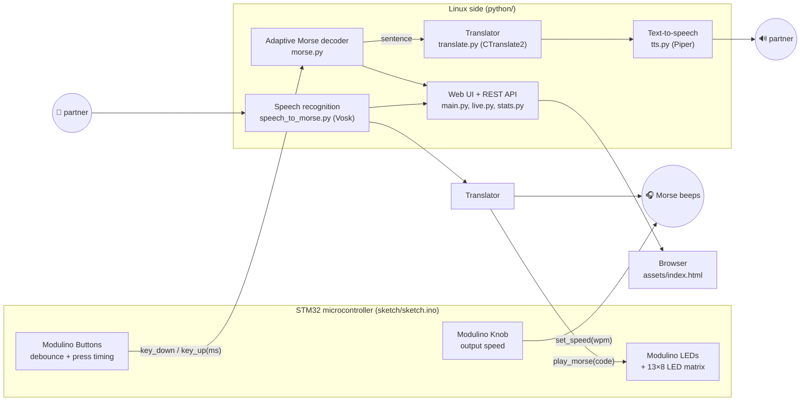

# MorseToSpeech

> This project is our contribution to the Speech To Speech Hackathon. A 24-hour build on the Arduino® UNO™ Q.

**A conversation device for deafblind people: anyone can just talk to them, and they feel the words as Morse code.
Built on an Arduino UNO Q, fully offline.**

People who can neither hear nor see are cut off from spoken conversation. Talking to them usually needs a trained
interpreter or a tactile sign language that most friends, nurses and doctors don't know.

MorseToSpeech removes that barrier. **The conversation partner simply speaks.** The device recognizes the speech and
turns it into **Morse code**, a signal that needs only one sense: **touch**. The deafblind person feels it as short and
long pulses, at a speed they set themselves.

To answer, they **tap Morse on a button**, entirely by feel, and the device speaks the sentence out loud for the
partner. It translates between languages if needed.

No cloud, no account, no internet connection. Every model runs on the board.

> **Status of the hackathon prototype:** the whole pipeline works (speech recognition, translation, Morse encoding,
> Morse input and speech output). The received Morse is currently played as a **tone and as blinking lights**, so it can
> be heard and seen in the demo. The **vibration output** that makes it usable by touch alone is the next step. It needs
> one motor on a pin, driven by the same code that already blinks the LEDs (see [Next steps](#next-steps)).

---

## Why Morse code?

Deafblind people have one reliable channel left for communication: **touch**. Every tactile method has to squeeze
language through that channel.

Morse code reduces language to **one signal: on or off**, which makes it ideal for touch:
- **One pulse is enough:** a single vibration motor can carry any sentence. No Braille display, no complex hardware.
- **The user sets the pace:** a knob slows the Morse down until it's comfortable to feel, from 5 to 30 words per minute.
- **Same code in both directions:** the user feels Morse to receive, and taps the same Morse on a button to answer.
  Both work without sight or hearing.
- **Learnable:** 26 letters made of short and long pulses, a lot less to learn than a tactile sign language.

The problem is that almost nobody around a deafblind person can send or read Morse. MorseToSpeech is the interpreter
in between: speech in, Morse out, and back again.

### Who it helps

| Person | How MorseToSpeech helps |
|---|---|
| **Deafblind people** | They receive spoken sentences as Morse they can feel, at their own speed, and answer by tapping. No interpreter has to be in the room. |
| **Their conversation partners** (family, nurses, doctors, strangers) | They just talk. No tactile sign language, no Morse knowledge needed. The device speaks the answers out loud. |
| **Caregivers and companions** | The live web page shows the whole conversation as text, so others can follow along. |
| **Conversations across languages** | Built-in offline translation (English ↔ German) in both directions. |

---

## Features

**Receiving: speech → Morse**
- **Listen at the press of a button.** Hold button C, and the device listens to the partner and recognizes their speech
  offline (Vosk).
- **Morse output, in sync.** In the prototype, a 700 Hz tone in the headset, the Modulino LEDs and the LED matrix all play
  the same code at the same time. The planned vibration motor is driven by the same signal.
- **The user's own speed.** Turn the Modulino Knob for 5–30 words per minute, and press it to reset. The knob works
  by feel. While turning, the matrix shows a speed bar, and a short preview plays at the new speed.
- **LED matrix Morse tape.** The board's 13×8 matrix shows a scrolling tape of what is received (bottom) and what is
  tapped (top), so the people around can see the Morse too.

**Answering: Morse → speech**
- **Tap with button A.** The device decodes your Morse and speaks it with a natural offline voice (Piper).
- **Adapts to the user.** The decoder learns your personal rhythm (dot, dash and pause lengths) while you type, so slow
  and fast tappers both work.
- **Speed calibration.** At startup you tap `PARIS`, the standard Morse timing word, and the decoder measures your
  exact timing.

**Around it**
- **Wake word on a Nicla Voice (optional).** The Nicla's Syntiant NDP120 chip listens for "Alexa" at very low power and
  sends a Bluetooth LE signal to the UNO Q. Today the app only logs it (`on_wake` in `python/main.py`). It is the
  hook for starting to listen without pressing button C.
- **Offline translation, English ↔ German, in both directions** (Argos Translate models via CTranslate2).
- **Live web page.** It shows what's being typed right now, the conversation as a chat with translations and Morse
  code, language selection, and device statistics (CPU, memory, temperature, power).
- **Fully offline and open source.** No data ever leaves the device.

---

## Hardware

| Part | Purpose |
|---|---|
| **Arduino UNO Q** (2 GB or 4 GB) | Runs everything: STM32 microcontroller for real-time input, Linux for the AI models |
| **Modulino Buttons** (Qwiic) | A = Morse key, B = backspace / recalibrate, C = speak / listen |
| **Modulino Knob** (Qwiic) | Morse output speed |
| **USB headset or speaker + microphone** | Hears the partner, speaks the user's answers. In the prototype it also plays the received Morse as a tone. |
| *Optional:* **Arduino Nicla Voice** | Always-on wake-word detector ("Alexa") that signals the UNO Q over Bluetooth LE |
| *Optional:* USB-C hub with HDMI + power delivery, and a (touch) monitor | Shows the live web page on the device itself |

Connect the Modulinos in a chain to the UNO Q's Qwiic connector. Connect the headset to the board, or to the hub.

---

## Get it running on your own device

### 1. Set up the board
1. Install [Arduino App Lab](https://docs.arduino.cc/software/app-lab/) on your computer, connect the UNO Q, and run
   through the first-time setup (Wi-Fi, updates).
2. Copy this repository into App Lab as an app, or clone it and open the folder in App Lab.

### 2. Add the library and the brick in App Lab
- **Sketch library:** add **Modulino** to the sketch. `Arduino_RouterBridge` and `Arduino_LED_Matrix` come with the
  UNO Q core.
- **Brick:** add the **Web UI** brick to the app. It serves the web page on port 7000.

The Python packages in `python/requirements.txt` (`piper-tts`, `vosk`, `ctranslate2`, `sentencepiece`) are installed
by App Lab when the app starts.

### 3. Download the models (once)
All models (about 530 MB in total) are downloaded with one command:

```bash
cd python
python download_models.py
```

This fetches two Piper voices (English, German), two Vosk speech-recognition models (English, German) and the Argos
translation models (en→de, de→en) into `python/voices/` and `python/models/`. Files that are already there are skipped.

You can run it on the board (over SSH, in the app's `python` folder) or on your computer, and then copy `python/voices/`
and `python/models/` onto the board. Both folders are ignored by git.

### 4. Start the app
Press **Run** in App Lab. The device greets you and asks you to tap `PARIS` for calibration. Press **C** to skip that and
use the default speed.

Open the web page at **`http://<board-ip>:7000`**, from any device on the same network or in the browser on the board's
own monitor.

### Optional: Nicla Voice wake word
1. Open `nicla_wake/nicla_wake.ino` in the Arduino IDE and flash it to the Nicla Voice. It uses the standard Syntiant
   packages already on the Nicla's flash (`mcu_fw_120_v91`, `dsp_firmware_v91`, `alexa_334_NDP120_B0_v11_v91`), and
   the libraries `NDP` and `ArduinoBLE`.
2. LED colors: yellow = loading, green = ready, blue = "Alexa" heard, blinking red = error (reboots by itself).
3. Power the Nicla. `python/wake.py` (needs `bleak`, already in `requirements.txt`) finds the BLE peripheral
   `NiclaWake`, subscribes, and reconnects automatically. Set `NICLA_BLE_ADDRESS` to skip the scan.
4. Debug: open the Nicla's USB serial port (115200 baud). Commands: `s` status, `t` send a test wake, `r` reboot.

The Bluetooth link carries only a wake counter (a uint32 that increases per detection), so missed wakes can be
noticed. Without a Nicla, the app runs normally.

### 5. How to use it

| Control | Action |
|---|---|
| **Button A** | Morse key: short press = dot, long press = dash |
| **Button B**, short | Backspace (removes the current dot/dash pattern, or the last letter) |
| **Button B**, hold | Recalibrate (tap `PARIS` again), e.g. when a different person uses the device |
| **Button C**, hold | **Listen to the partner.** Their speech is played to you as Morse (in the prototype: tone + light). |
| **Button C**, short | Speak your tapped sentence out loud (translated, if the partner speaks another language) |
| **Knob**, turn / press | Morse output speed: right = faster, left = slower; press = back to 15 wpm |
| **Web page** | Choose your language and your partner's language, follow the conversation, see device statistics |

Letters end automatically when you pause, and words end after a longer pause. When both people speak the same
language, every finished word is spoken right away. With translation on, the device waits for **C**, because
translation needs the whole sentence.

### 6. Run the tests (on any computer)
```bash
cd python
python -m pytest
```
The decoder, calibration, encoding, translation and statistics are covered. The translation tests are skipped if the
models aren't downloaded.

---

## How it works

### Architecture



The **microcontroller** does everything where timing matters: it measures how long each key press lasts to the
millisecond, reads the knob, and drives the LEDs and the LED matrix without blocking. It talks to the **Linux side**
over the UNO Q's Bridge (RPC). Linux runs the language models, the audio and the web server.

### Models

All models are small enough to run on the UNO Q's ARM CPU, with no GPU and no cloud.

| Task | Model | Runtime | Size |
|---|---|---|---|
| Text-to-speech | Piper `en_US-lessac-medium`, `de_DE-thorsten-medium` | ONNX Runtime (`piper-tts`) | ~63 MB per voice |
| Speech recognition | Vosk `vosk-model-small-en-us-0.15`, `vosk-model-small-de-0.15` | Kaldi (`vosk`), streaming | ~40–45 MB per language |
| Translation | Argos Translate `en_de` / `de_en` 1.3 (Transformer) | CTranslate2, **int8**, + SentencePiece | ~157 MB per direction |

Fallback: if a Piper voice is missing, `espeak-ng` is used.

### Key parts

**Adaptive Morse decoder** (`python/morse.py`)
- Every press is classified as a dot or a dash by comparing it with a threshold halfway between the user's average dot
  and dash. Both averages are updated after every press (exponential moving average), so the decoder follows the user
  as they get faster or tired.
- Pauses are learned, too: the decoder measures how long this person pauses inside a letter and between letters, and
  places the "letter finished" and "word finished" thresholds accordingly. Real users pause much longer than textbook
  Morse timing, so this is what turns single letters into words.
- **Calibration:** the user taps `PARIS`. Since we know which of the 14 presses must be dots or dashes, we can measure
  the user's exact timing instead of guessing. If dots and dashes overlap, it asks again.

**Translation** (`python/translate.py`)
- We run the Argos Translate model files directly with CTranslate2 in **int8**, instead of the `argostranslate`
  package, which would pull in PyTorch. That keeps the install small, and int8 makes inference faster and lighter. On
  a laptop a sentence takes about 50 ms.
- Morse text arrives in ALL CAPS without punctuation, so it's normalized first ("I NEED WATER" → "I need water.").
  Speech recognition gives no punctuation either, so questions are detected from the first word ("hast du …",
  "where …") and get a question mark. Otherwise the translation would turn them into statements.

**Speech → Morse** (`python/speech_to_morse.py`)
- Vosk listens until the partner pauses, at most 8 s.
- The text is translated, encoded to Morse and played as a 700 Hz tone. At the same time it's sent to the
  microcontroller, which blinks the same code on the LEDs and the matrix, in sync, at the speed set with the knob.

**Live web page** (`assets/index.html`, `python/live.py`, `python/stats.py`)
- A single static page, served by the App Lab Web UI brick, with no external scripts or fonts, so it works offline.
- It polls small REST endpoints:

  | Endpoint | Returns | How often |
  |---|---|---|
  | `GET /api/live?since=<id>` | typing state + new conversation events | 5× per second |
  | `GET /api/stats` | CPU, RAM, temperature, power | every 2 s |
  | `GET/POST /api/languages` | language selection | on change |

- Incoming Morse lights up symbol by symbol on the page, in time with the beeps and LEDs.
- Device statistics are read straight from `/proc` and `/sys`. Power is shown as measured if the board exposes a power
  sensor. Otherwise you can enter your own USB power-meter readings (`MORSE_IDLE_W`, `MORSE_FULL_W`) to get an
  estimate. We don't show invented numbers.

### Green and free by design
- **Offline:** no data centre is involved in a conversation, and nothing personal leaves the device.
- **Small models:** medium voices instead of high-quality ones (about 6× less compute), int8 translation, and the
  "small" Vosk models.
- **Load on demand:** translation models and extra voices are only loaded when the selected languages need them.
- **Measured, not guessed:** the web page shows CPU, memory and translation time, so the footprint is visible.
- **Open source throughout:** Piper, Vosk, CTranslate2, SentencePiece, Argos Translate models, Arduino libraries.

### Project structure

```
sketch/sketch.ino           STM32: buttons, knob, LEDs, LED matrix, Bridge events
python/main.py              wires everything together, Bridge handlers, web API
python/morse.py             adaptive decoder, calibration, Morse encoding
python/tts.py               Piper text-to-speech (one voice per language)
python/speech_to_morse.py   Vosk speech recognition → Morse beeps
python/translate.py         offline translation (CTranslate2 + SentencePiece)
python/languages.py         user/partner language settings
python/live.py              live state + conversation log for the web page
python/stats.py             CPU / RAM / temperature / power statistics
python/wake.py              BLE listener for the Nicla Voice wake word
python/download_models.py   downloads all models
nicla_wake/nicla_wake.ino   Nicla Voice: "Alexa" detection, BLE wake signal
assets/index.html           the web page
```

---

## Limitations

- **Two languages so far:** English and German. More languages need one Piper voice, one Vosk model and a pair of Argos
  models each.
- **Speech recognition** with the small Vosk models gets worse in noisy rooms.
- **Same-language mode** speaks every word on its own, which sounds less fluent than a whole sentence (button C).
- **The conversation history** lives in memory only and is cleared when the app restarts.
- **No tactile output yet:** the prototype plays received Morse as a tone and as light. Until the vibration output is
  built, a deafblind person can't use it on their own.
- **Starting a conversation:** listening is started by holding button C. The deafblind person, or the partner, has to
  press it.

## Next steps

- **Vibration output (highest priority):** a vibration motor that taps the received Morse onto the wrist or the
  fingertip, at the speed set with the knob. This is the step that makes the device usable by touch alone. The code
  path is already there: every message is sent to the microcontroller as Morse (`play_morse`), and the player that
  blinks the LEDs can drive a motor pin the same way.
- **Wearable form:** the button and the vibration motor in one small housing, held in one hand: feel with one finger,
  tap with another.
- **Touch feedback while typing:** a short vibration when a letter is recognized, and a different one when the sentence
  has been spoken, so the user knows the device understood them.
- **Hands-free input:** a head nod (Modulino Movement) or a hand moving closer (Modulino Distance) as the Morse key,
  for people who can't press a button.
- **Phrase shortcuts and word prediction**, to need fewer taps per sentence.
- **Personal voice:** train a Piper voice from recordings made before someone loses their voice.
